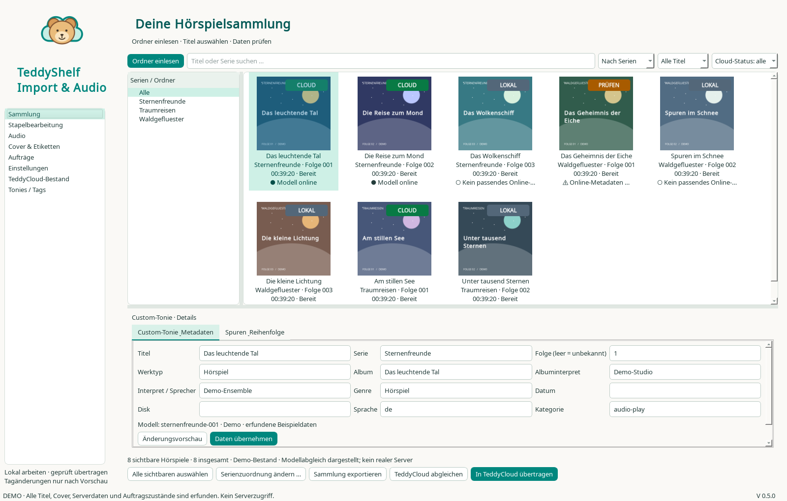
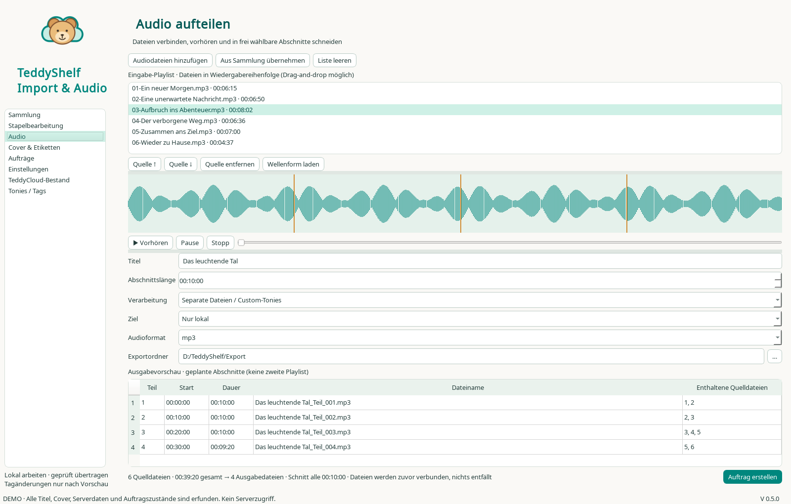
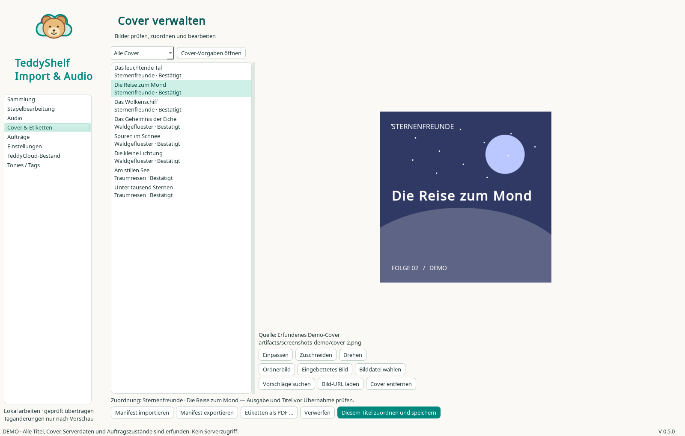
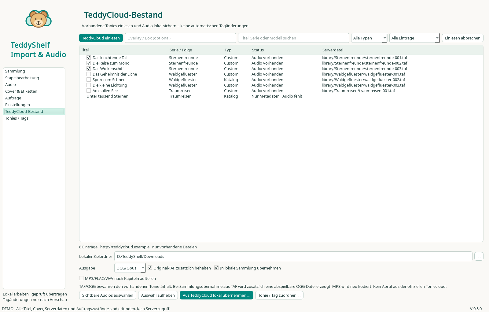
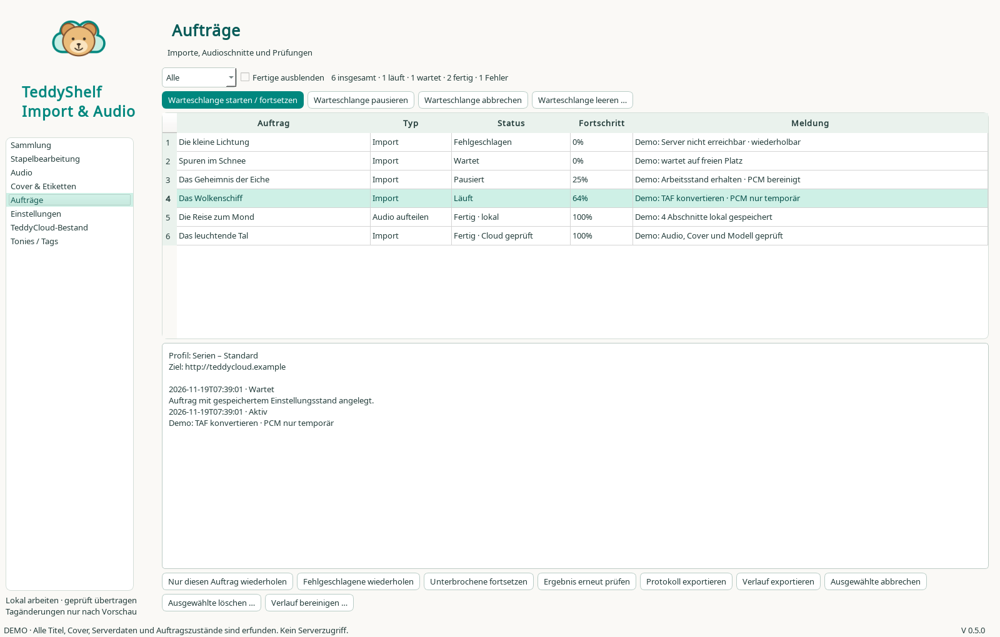
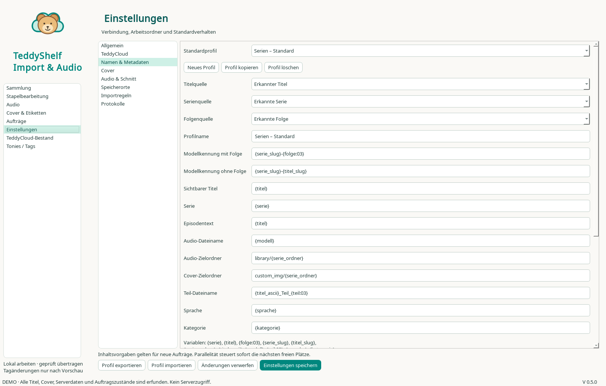

# TeddyShelf

**TeddyShelf hieß bisher TeddyStudio.** Da TeddyCloud bereits eine Funktion mit dem Namen **TeddyStudio** enthält, wurde dieses eigenständige Programm in **TeddyShelf** umbenannt, um Verwechslungen zu vermeiden. Die Umbenennung ändert weder die Verbindung zu TeddyCloud noch vorhandene Einstellungen oder Sammlungsdaten.

Eigenständige Windows-Anwendung für Hörspielsammlungen, Metadaten, Cover, Audioschnitt und geprüfte TeddyCloud-Importe. Oberfläche nach Coverbibliothek B: Serien-/Ordnerauswahl, Coverkarten und Detailbereich unter der Sammlung.

## Einblicke in die Anwendung

Die Screenshots zeigen die echte Oberfläche mit ausschließlich erfundenen Beispieldaten und selbst erstellten Demo-Covern. Titel, Serverbestand, Wellenform und Auftragszustände sind zur Veranschaulichung simuliert; es werden keine privaten Sammlungsdaten gezeigt.

**Sammlung:** Serien und Ordner durchsuchen, Cloud-/Lokal-/Prüfen-Markierungen erkennen und Custom-Tonie-Metadaten bearbeiten.

Audio: Playlist, Wellenform und Ausgabevorschau

Sechs Quelldateien ergeben hier vier Abschnitte mit zehn Minuten Länge und einem vollständigen Rest. Die Ausgabevorschau zeigt, welche Quellen in jedem Teil enthalten sind.

Cover: Auswahl, Bearbeitung und eindeutige Zuordnung

Cover für den ausgewählten Titel prüfen, einpassen, zuschneiden oder drehen und anschließend gezielt zuordnen. Die Beispielbilder wurden eigens für diese Dokumentation erstellt.

TeddyCloud-Bestand: vorhandene Inhalte lokal übernehmen

Custom- und Katalogeinträge unterscheiden, vorhandene Audiodateien auswählen und lokal sichern. Der letzte Demo-Eintrag zeigt den Unterschied zwischen vorhandenen Metadaten und fehlendem Audio.

Aufträge: Fortschritt, Pause, Wiederaufnahme und Protokolle

Simulierte Beispiele für wartende, laufende, pausierte, fertige und fehlgeschlagene Aufträge. Warteschlange und einzelne Aufträge lassen sich getrennt steuern.

Einstellungen: Namen und Metadaten über Profile steuern

Modellkennungen, sichtbare Titel, Dateinamen und Zielordner mit Vorlagen konfigurieren. Folgenummern und Abschnittsnummern sind getrennt einstellbar.

## Starten

TeddyShelf hieß bisher TeddyStudio. Vorhandene Einstellungen und Sammlungsdaten werden weiterhin aus `%LOCALAPPDATA%/TeddyStudio` geladen, wenn dort eine bisherige Installation vorhanden ist und im neuen Datenordner noch keine eigene Konfiguration liegt. Neue Installationen verwenden `%LOCALAPPDATA%/TeddyShelf`. `TEDDYSHELF_DATA` hat Vorrang; das bisherige `TEDDYSTUDIO_DATA` wird weiterhin unterstützt. Interne Python-Importpfade und vorhandene Export-Manifeste behalten aus Kompatibilitätsgründen ihren bisherigen technischen Namen.

Das portable Windows-Paket vollständig entpacken und **TeddyShelf.exe** öffnen. Python und TonieToolbox müssen nicht installiert sein. FFmpeg, FFprobe, Qt und die benötigten Python-Bibliotheken werden mitgeliefert. Einstellungen und Aufträge liegen unter `%LOCALAPPDATA%/TeddyShelf`; ein anderer Datenordner kann über `TEDDYSHELF_DATA` gewählt werden.

1. Unter **Einstellungen** die TeddyCloud-Adresse, Quell- und Exportordner konfigurieren. Bei selbstsigniertem HTTPS das eigene CA-Zertifikat auswählen oder die Zertifikatsprüfung bewusst für den LAN-Server ausschalten. Verbindung testen.
2. **Sammlung → Ordner einlesen** liest Unterordner und fasst Audiospuren desselben Ordners zu einem Hörspiel zusammen. Unsichere Zuordnungen prüfen. Lose Käptn-Sharky-Ordner werden als Serie erkannt; unbekannte Folgenummern bleiben leer.
3. Hörspiele auswählen, Informationen und Reihenfolge prüfen. Änderungen in der Sammlung verändern keine Quell-Tags. Die gesonderte Tag-Schreibaktion erstellt vor jeder Datei eine Sicherung.
4. Cover bei Bedarf unter **Cover & Etiketten** zuordnen. Fehlende Cover verhindern den Import nicht. Online-Suche öffnet eine Bildsuche; direkte Bildadressen werden als unbestätigte Vorschläge geladen. Ein Bild wird erst durch die ausdrückliche Zuordnung gespeichert.
5. Importvorschau prüfen und Aufträge erstellen. Erfolg wird erst nach vollständiger TAF-Dekodierung, Bytevergleich der Serverdateien, Prüfung des Server-Headers und Lesen des Custom-Tonie-Modells bestätigt.

## Audio aufteilen

Audiodateien hinzufügen oder aus der Sammlung übernehmen; Reihenfolge per Drag-and-drop oder über die Pfeile ändern. Abschnittslänge in HH:mm:ss wählen. Die Vorschau zeigt den erhaltenen Rest. Ausgabe als MP3, Opus, FLAC oder WAV, alternativ als TAF mit Kapiteln. Ziel: lokal, TeddyCloud oder beides. Separate Teile erzeugen bei Serverausgabe separate Custom-Tonies. Die Quellen bleiben unverändert. Für den Kapitelmodus ist TAF fest vorgegeben.

Unter **Verarbeitung** stehen drei Möglichkeiten bereit: separate Dateien nach Zeitabschnitten, eine TAF mit Zeitkapiteln oder **TAF als Playlist (Originaldateien vollständig)**. Im Playlist-Modus wird jede Quelldatei vollständig als eigenes Kapitel in Listenreihenfolge übernommen. Es gibt keinen Zeitschnitt und keine Kürzung; die Abschnittslänge ist deaktiviert. Die Vorschau und die Markierungen in der Wellenform folgen den Dateigrenzen. Für TAF wird das Audio neu kodiert, die Originaldateien bleiben unverändert. Unter **Einstellungen → Audio & Schnitt → Standard-Verarbeitung** lässt sich der bevorzugte Modus speichern.

## Aufträge und Wiederaufnahme

PCM ist unkomprimiertes temporäres Arbeitsaudio (48 kHz, Stereo, 16 Bit: etwa 691 MB pro Stunde). Es wird nach Erfolg, Fehler, Pause und Abbruch entfernt. Beim Programmstart werden liegen gebliebene PCM-Dateien in inaktiven Auftragsordnern bereinigt. Unter **Einstellungen → Protokolle → Temporäre Audiodaten bereinigen** ist das auch manuell möglich. Aktive Aufträge sind über eine Prozesssperre geschützt. Quellen, fertige Exporte, geprüfte TAF-Zwischenergebnisse und Protokolle bleiben erhalten. Bei Wiederaufnahme wird erforderliches PCM erneut erzeugt. Während paralleler Konvertierungen wird entsprechend mehr temporärer Speicher benötigt.

Jeder Auftrag speichert Metadaten, Profil und Einstellungen. Beim Start erfolgt kein automatischer Serverimport. Die Warteschlange kann insgesamt gestartet/fortgesetzt, pausiert, abgebrochen und geleert werden. Pausieren beendet auch laufende Arbeitsprozesse samt Konvertern und behält die Arbeitsstände; Fortsetzen prüft vorhandene Ergebnisse erneut. Ein unterbrochener einzelner Konvertierungsschritt kann neu beginnen. Einzelne oder ausgewählte Aufträge lassen sich unabhängig vom Status abbrechen und löschen. Bereits gespeicherte Audio- und TeddyCloud-Dateien werden dadurch nicht zurückgenommen.

Unter **Einstellungen → Allgemein** sind 1 bis 16 gleichzeitige Aufträge einstellbar, Standard 1. Lokale Vorbereitung und Konvertierung können parallel laufen; Übertragungen und Modelländerungen bleiben je TeddyCloud-Ziel nacheinander. Fertige Aufträge bleiben standardmäßig sichtbar. Geänderte Quellen werden erkannt; dafür einen neuen Auftrag anlegen. Protokolle und Verlauf lassen sich als JSON exportieren. Bestätigte Importaufträge können mit „Ergebnis erneut prüfen“ ohne Serveränderungen geprüft werden.

Beim Schließen während laufender Aufträge lässt sich zwischen **Aufträge abbrechen und beenden** und **Programm weiter ausführen** wählen. Nach bestätigtem Abbruch schließt die Anwendung automatisch, sobald Konverter beendet und temporäre Audiodaten bereinigt sind. Die Programmversion steht dauerhaft rechts unten in der Statusleiste.

## Namen und Metadaten

Profile steuern Modellkennung, sichtbaren Titel, Serie, Episodentext, Sprache, Kategorie, Dateinamen und Zielordner. Variablen werden in der Oberfläche erklärt und live geprüft. Folge, Track und Split-Teil sind getrennt. ASCII-Pfade werden erzwungen, reservierte Windows-Namen und Pfadnavigation abgewiesen. Beispiele: `bibi-tina-001`, `library/Bibi-Tina`, `custom_img/Bibi-Tina`. Unbekannte Folgen werden anhand eines Titelslugs benannt. Übertragungen ändern keine RFID-Zuordnung automatisch.

## Cover und Etiketten

Ordnerbild, eingebettetes Bild, manuelle Datei oder bestätigte Online-Quelle; Bildprüfung, Rotation, grafischer Zuschnittrahmen direkt im Bild und Größenbegrenzung. Cover-Manifest als JSON importieren/exportieren, Zuordnungen nur anhand eindeutiger Ordner oder IDs und nach Vorschau. Etiketten werden als A4-PDF mit frei wählbarer quadratischer Kantenlänge und Titel exportiert. Beim Drucken 100 % / tatsächliche Größe verwenden.

## Entwicklung

Python 3.11–3.13 (getestet: 3.13.9), Windows x64. `python -m pip install -e . pytest pyinstaller`, FFmpeg/FFprobe unter `tools/` ablegen. `python launch.py` startet die Anwendung. `python -m pytest -q` führt die Tests aus. `python scripts/build_windows.py` erstellt das portable ZIP. Weitere Hinweise: [Build](docs/BUILD.md), [Architektur](docs/ARCHITECTURE.md), [TAF-Format](docs/FORMAT.md), [Funktionsmatrix](docs/FUNCTIONS.md).

Die Dokumentationsbilder lassen sich mit `python scripts/make_screenshots.py` aus dem Repository-Verzeichnis neu erzeugen. Der Generator verwendet einen isolierten temporären Datenordner, erfundene Inhalte und gesperrte Serverzugriffe. Er verändert weder die persönliche Sammlung noch vorhandene Einstellungen.

## Vorhandene TeddyCloud-Inhalte und Tonies

**TeddyCloud** liest Custom- und Katalogmodelle sowie tatsächlich vorhandene Dateien ein. Audio-ID und Hash ordnen Audiodateien zu; reine Metadateneinträge sind nicht herunterladbar. Ausgewählte Inhalte lassen sich über die Warteschlange lokal als Original-TAF und OGG oder als MP3, FLAC und WAV sichern, optional mit einzelnen Kapiteln und Aufnahme in die Sammlung. Die App liest vorhandene Serverdateien; sie fordert keinen Download aus der Herstellercloud an. Cover werden nur von passenden lokalen Serverpfaden übernommen. Unterbrochene Downloads werden fortgesetzt und anschließend vollständig geprüft.

**Tonies / Tags** bearbeitet die Zuordnung konkreter RUIDs zu Modellen und lokalen Audiodateien. Bestehende Werte zuerst laden, Änderungen in der Vorschau prüfen und als Auftrag speichern. Vor dem Schreiben wird erneut auf zwischenzeitliche Änderungen geprüft; anschließend erfolgt eine Rückleseprüfung. Es wird kein NFC-Chip beschrieben. Import und Download ändern diese Zuordnungen nicht automatisch.

Eine erfolgreiche technische Prüfung ersetzt keinen Hörtest auf einer physischen Toniebox.

TeddyShelf ist ein unabhängiges Projekt und kein Produkt des Herstellers der Toniebox.
100% mit codex erstellt und für den Heimgebrauch gedacht

Der [Prüfbericht](docs/VALIDATION.md) dokumentiert den aktuellen Quellstand und die Grenzen der Prüfung. Hinweise zur Veröffentlichung und zum Schutz lokaler Daten stehen unter [Datenschutz](docs/PRIVACY.md).
